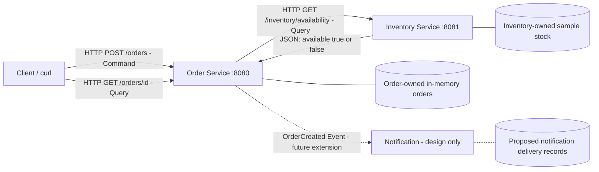
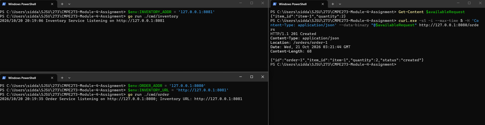
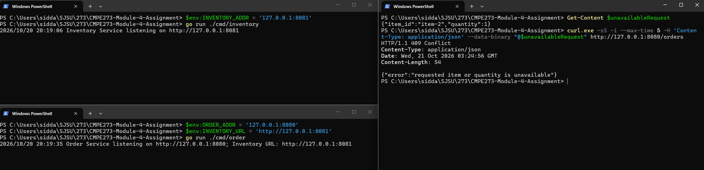
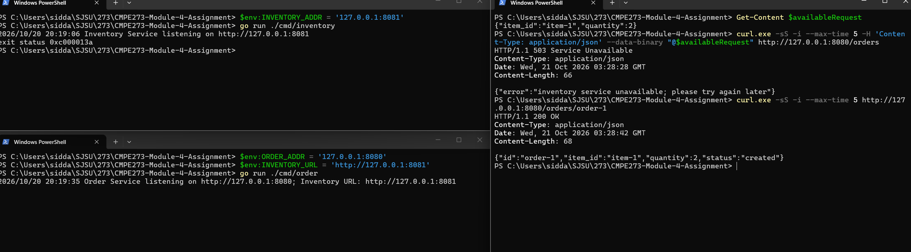
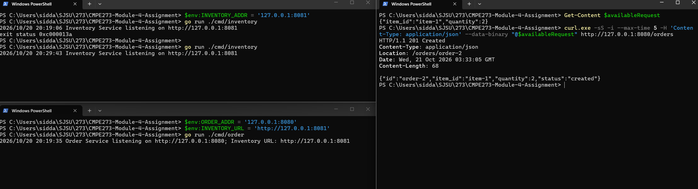

# CMPE273 Module 4: Distributed Online Store in Go

This project demonstrates service boundaries, data ownership, HTTP communication, and dependency failure handling using an online store.

## Architecture design



Order and Inventory run as independent Go processes and communicate over HTTP. Notification is a proposed event consumer; an event broker and notification delivery are outside the required implementation.

## Responsibilities and data ownership

| Component | Responsibility | Owned data |
|---|---|---|
| Order | Validate order commands, query Inventory, create and track accepted orders | Order IDs, item references, requested quantities, order status |
| Inventory | Answer availability queries for an item and quantity | Item IDs and available stock quantities |
| Notification (design only) | React to an OrderCreated event and notify the user | Proposed notification IDs, order references, recipients, delivery status |

Inventory is the authority for stock. Order queries Inventory's HTTP API instead of reading its memory or maintaining a second stock table. Order owns the order lifecycle; Notification would own delivery and retries independently. These boundaries follow business responsibilities and allow each service to change without exposing its internal storage. An item ID stored in an order is a reference, not ownership of inventory data.

## Command / Query / Event

| Interaction | Classification | Why |
|---|---|---|
| Check whether an item is available | **Query** | Reads inventory without changing it. Implemented endpoint: GET /inventory/availability. |
| Create an order | **Command** | Requests a state change that may be accepted or rejected. Implemented endpoint: POST /orders. |
| Order was created | **Event** | Describes a completed fact. OrderCreated is conceptual in this assignment. |

Looking up an existing order with GET /orders/{id} is also a Query. An availability query does not reserve or deduct stock; stock reservation would require a separate operation.

## Prerequisites and dependencies

Install Go 1.22 or newer and verify it with:

```powershell
go version
```

If Go is installed but missing from PATH, use:

```powershell
& 'C:\Program Files\Go\bin\go.exe' version
```

The project uses only Go's standard library. No external packages, database, or message broker are required.

## Run Inventory

From the repository root, start the Inventory process:

```powershell
go run ./cmd/inventory
```

The service listens at `http://127.0.0.1:8081`. Press Ctrl+C in that terminal to stop it. To choose another listening address, set `$env:INVENTORY_ADDR = '127.0.0.1:9081'` before starting it.

Inventory owns this sample stock in memory:

| Item | Available quantity |
|---|---:|
| `item-1` | 10 |
| `item-2` | 0 |
| `item-3` | 5 |

The endpoint is `GET /inventory/availability?item_id=<id>&quantity=<positive integer>`. It compares the requested quantity with the item's stock and returns JSON. The query does not change stock; restarting the process restores the same sample data.

### Try the availability query

In another terminal:

```powershell
curl.exe -i "http://127.0.0.1:8081/inventory/availability?item_id=item-1&quantity=2"
```

Expected status and body (other HTTP headers omitted):

```text
HTTP/1.1 200 OK
{"item_id":"item-1","quantity":2,"available":true}
```

Try an out-of-stock item:

```powershell
curl.exe -i "http://127.0.0.1:8081/inventory/availability?item_id=item-2&quantity=1"
```

```text
HTTP/1.1 200 OK
{"item_id":"item-2","quantity":1,"available":false}
```

Unknown items and requests exceeding the available quantity also return `200` with `available:false`. This is a successful query reporting an unavailable item.

Missing item IDs or quantities that are missing, noninteger, zero, or negative return `400 Bad Request`:

```powershell
curl.exe -i "http://127.0.0.1:8081/inventory/availability?item_id=item-1&quantity=0"
```

```text
HTTP/1.1 400 Bad Request
{"error":"item_id and a positive integer quantity are required"}
```

### Inventory code and tests

- `cmd/inventory/main.go` starts the process, configures the listening address, and supplies sample stock.
- `internal/inventory/inventory.go` owns a copy of the stock and handles availability queries.
- `internal/inventory/inventory_test.go` checks available stock, the exact stock limit, insufficient stock, out-of-stock and unknown items, and invalid input. It also verifies that changing the caller's stock map cannot change Inventory's owned data.

Run the checks from the repository root:

```powershell
go test ./...
go vet ./...
```

The Inventory tests exercise the HTTP handler without needing a running service.

## Run Order

Keep Inventory running in terminal 1. In terminal 2, from the repository root, start Order as a separate process:

```powershell
go run ./cmd/order
```

Order listens at `http://127.0.0.1:8080` and connects to Inventory at `http://127.0.0.1:8081`. It never accesses Inventory's in-memory stock directly.

Optional environment variables, set before starting Order:

| Variable | Default | Purpose |
|---|---|---|
| `ORDER_ADDR` | `127.0.0.1:8080` | Order's listening address |
| `INVENTORY_URL` | `http://127.0.0.1:8081` | Inventory's HTTP base URL |

For example, if Inventory was started on port 9081, set `$env:INVENTORY_URL = 'http://127.0.0.1:9081'` in terminal 2 before starting Order.

### Create an order

In terminal 3, write the JSON body to a file to avoid differences in PowerShell's native argument quoting:

```powershell
'{"item_id":"item-1","quantity":2}' | Set-Content -Encoding ascii -Path "$env:TEMP\store-order.json"
curl.exe -i -H "Content-Type: application/json" --data-binary "@$env:TEMP\store-order.json" http://127.0.0.1:8080/orders
```

For a fresh Order process, the expected status, Location header, and JSON body are:

```text
HTTP/1.1 201 Created
Location: /orders/order-1
{"id":"order-1","item_id":"item-1","quantity":2,"status":"created"}
```

The request follows these steps:

1. Order validates the item ID and positive integer quantity.
2. Order makes an HTTP availability query to Inventory with a two-second timeout.
3. Inventory returns whether the requested quantity is available.
4. If available, Order stores a new order in its own memory and returns `201` with the order details. If unavailable, it returns `409` without creating an order.

### Track an order

Use the ID returned by the creation request:

```powershell
curl.exe -i http://127.0.0.1:8080/orders/order-1
```

```text
HTTP/1.1 200 OK
{"id":"order-1","item_id":"item-1","quantity":2,"status":"created"}
```

An unknown order ID returns `404 Not Found`. Looking up an existing order reads only Order's data, so it does not depend on Inventory being available.

### Unavailable stock and errors

Submit an out-of-stock item:

```powershell
'{"item_id":"item-2","quantity":1}' | Set-Content -Encoding ascii -Path "$env:TEMP\store-order.json"
curl.exe -i -H "Content-Type: application/json" --data-binary "@$env:TEMP\store-order.json" http://127.0.0.1:8080/orders
```

```text
HTTP/1.1 409 Conflict
{"error":"requested item or quantity is unavailable"}
```

| Result | HTTP status |
|---|---|
| Order created | `201 Created` |
| Invalid JSON, unknown JSON fields, missing item ID, or nonpositive/noninteger quantity | `400 Bad Request` |
| Item unknown or requested quantity unavailable | `409 Conflict` |
| Inventory unreachable, timed out, or returned an invalid response | `503 Service Unavailable` |
| Lookup of an unknown order | `404 Not Found` |

Dependency failures return this JSON error rather than terminating Order:

```json
{"error":"inventory service unavailable; please try again later"}
```

Order also treats non-200 Inventory responses and malformed or mismatched availability results as dependency failures. Rejected or failed requests do not create orders or consume order IDs. A mutex protects Order's in-memory state when requests arrive concurrently.

Orders and IDs reset when Order restarts. Checking stock does not reserve or deduct it, so repeated accepted orders can exceed sample stock in aggregate. Atomic stock reservations would be a separate Inventory command in a more complete store.

### Order code and tests

- `cmd/order/main.go` configures and starts the independent Order process.
- `internal/order/order.go` validates commands, queries Inventory through HTTP, stores accepted orders, and supports order lookup.
- `internal/order/order_test.go` checks creation, lookup, input validation, stock rejection, dependency errors, timeouts, and continued access to stored orders after Inventory stops.

Run `go test ./...` and `go vet ./...` from the repository root. Order tests start temporary local HTTP servers automatically; they do not require manually started services. Both commands passed during implementation. The separate-process verification below additionally tests the compiled services communicating over HTTP.

## Inventory failure test

To reproduce the required failure test manually:

1. Start Inventory and Order in separate terminals using the commands above.
2. Submit the successful `item-1`, quantity `2` order and note the returned order ID.
3. Stop Inventory with **Ctrl+C in terminal 1**. Leave Order running in terminal 2.
4. Submit the same order request again. It returns `503 Service Unavailable` with the error `inventory service unavailable; please try again later`.
5. Submit it once more and look up the previously created order. New orders still receive `503`, while the stored-order lookup returns `200`. Order continues running throughout the outage.
6. Restart Inventory with `go run ./cmd/inventory`, then submit another order. It returns `201 Created` without restarting Order.

This demonstrates that a failed dependency prevents new orders from being accepted, but does not crash the Order Service or prevent it from answering queries about its own data.

### Automated reproduction

From the repository root in PowerShell:

```powershell
.\scripts\verify.ps1
```

The script requires Go and `curl.exe`. It builds and starts two independent executables, verifies successful and rejected requests, stops Inventory, checks repeated failures and stored-order access, restarts Inventory, and checks recovery. It uses ports **18080 and 18081** so the manual services can remain on 8080 and 8081. It checks expected HTTP statuses and throws an error if a check fails.

The script stops its own processes when it finishes and restores any environment variables it temporarily changed. Build outputs and service logs are in the ignored `bin/` directory. Its Go build and module caches are in the ignored `.cache/` directory.

To choose different free ports or a custom Go installation:

```powershell
.\scripts\verify.ps1 -OrderPort 19080 -InventoryPort 19081 -GoExe 'C:\Program Files\Go\bin\go.exe'
```

To capture another run, use:

```powershell
.\scripts\verify.ps1 | Tee-Object -FilePath docs\verification.txt
```

### Captured result

The full, actual request/response output is saved in [docs/verification.txt](docs/verification.txt). The following excerpt shows the successful order, dependency failure, continued operation, and recovery from that run. Blank lines between responses and status codes have been omitted for readability. Process IDs will differ on another run.

```text
Independent processes: Order PID=23124, Inventory PID=33860

Successful order
POST http://127.0.0.1:18080/orders
{"item_id":"item-1","quantity":2}
{"id":"order-1","item_id":"item-1","quantity":2,"status":"created"}
HTTP 201

Stopped Inventory PID=33860

Dependency failure
POST http://127.0.0.1:18080/orders
{"item_id":"item-1","quantity":2}
{"error":"inventory service unavailable; please try again later"}
HTTP 503

Repeated dependency failure
POST http://127.0.0.1:18080/orders
{"item_id":"item-1","quantity":2}
{"error":"inventory service unavailable; please try again later"}
HTTP 503

Stored order still accessible during outage
GET http://127.0.0.1:18080/orders/order-1
{"id":"order-1","item_id":"item-1","quantity":2,"status":"created"}
HTTP 200
Order PID=23124 remains running.

Restarted Inventory PID=22404

Recovery with the same Order process
POST http://127.0.0.1:18080/orders
{"item_id":"item-1","quantity":2}
{"id":"order-2","item_id":"item-1","quantity":2,"status":"created"}
HTTP 201

PASS: success, rejection, dependency failure, continued operation, and recovery verified.
```

## Screenshots

Save the four screenshots below in `docs/screenshots/` using the exact filenames shown. These image slots will display the screenshots once the PNG files are added. See the [screenshot capture guide](docs/screenshots/README.md) for the commands and capture sequence.

### 1. Successful order with both services running

Show Inventory and Order running in separate terminals, along with a request that returns `201 Created` and the new order's JSON.



### 2. Unavailable item

Show the request for `item-2` and its `409 Conflict` response.



### 3. Inventory failure with Order still running

Show Inventory's terminal after Ctrl+C, a new order returning `503 Service Unavailable`, and an existing order lookup returning `200 OK`. Keep Order's running terminal visible.



### 4. Recovery after restarting Inventory

Show Inventory restarted and a new order returning `201 Created`, with the original Order process still running.



## Reflection

Clear service boundaries give each component a focused responsibility, making it easier to understand, test, and change independently. Explicit data ownership establishes which service is authoritative and prevents other services from changing its state behind its API. Communication through defined interfaces also makes dependencies and their failure modes visible, as shown when Order returns a controlled error during an Inventory outage. These boundaries support independent deployment and growth, while requiring careful decisions about consistency and coordination when a business operation spans multiple services.

## Submission

GitHub repository: [SiddarthVuppunahalli/CMPE273-Module-4-Assignment](https://github.com/SiddarthVuppunahalli/CMPE273-Module-4-Assignment)
