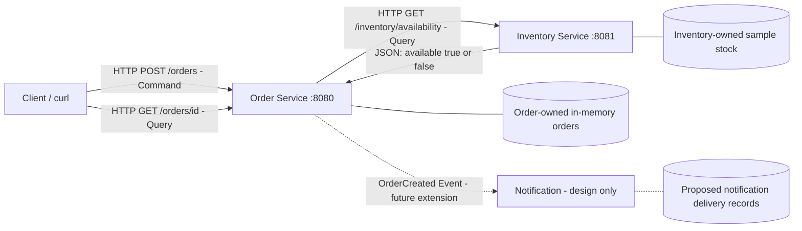

# CMPE273 Module 4: Distributed Online Store in Go

This project will demonstrate service boundaries, data ownership, HTTP communication, and dependency failure handling using an online store.

## Architecture design



This is the planned architecture. Order and Inventory will run as independent Go processes. Notification is a proposed event consumer; an event broker and notification delivery are outside the required implementation.

## Responsibilities and data ownership

| Component | Responsibility | Owned data |
|---|---|---|
| Order | Validate order commands, query Inventory, create and track accepted orders | Order IDs, item references, requested quantities, order status |
| Inventory | Answer availability queries for an item and quantity | Item IDs and available stock quantities |
| Notification (design only) | React to an OrderCreated event and notify the user | Proposed notification IDs, order references, recipients, delivery status |

Inventory is the authority for stock. Order will query Inventory's HTTP API instead of reading its memory or maintaining a second stock table. Order owns the order lifecycle; Notification would own delivery and retries independently. These boundaries follow business responsibilities and allow each service to change without exposing its internal storage. An item ID stored in an order is a reference, not ownership of inventory data.

## Command / Query / Event

| Interaction | Classification | Why |
|---|---|---|
| Check whether an item is available | **Query** | Reads inventory without changing it. Planned endpoint: GET /inventory/availability. |
| Create an order | **Command** | Requests a state change that may be accepted or rejected. Planned endpoint: POST /orders. |
| Order was created | **Event** | Describes a completed fact. OrderCreated is conceptual in this assignment. |

Looking up an existing order with GET /orders/{id} will also be a Query. An availability query will not reserve or deduct stock; stock reservation would require a separate operation.

## Prerequisites and dependencies

Install Go 1.22 or newer and verify it with:

```powershell
go version
```

If Go is installed but missing from PATH, use:

```powershell
& 'C:\Program Files\Go\bin\go.exe' version
```

The project will use only Go's standard library. No external packages, database, or message broker are required.

## Implementation steps

1. **Project setup and architecture (current step):** establish the Go module, ignore generated files, document service boundaries and interaction types.
2. **Inventory:** implement the independent availability service with sample stock, add tests, and document how to run and query it.
3. **Order:** implement order creation and tracking, query Inventory over HTTP with a timeout, handle failures, and add tests and request examples.
4. **Verification and submission documentation:** run both processes, stop and restart Inventory, capture actual output, and complete the README with evidence and a 3-5 sentence reflection.

Each step will be reviewed and committed before proceeding to the next. Service run commands and observed results will be added as those steps are completed.
